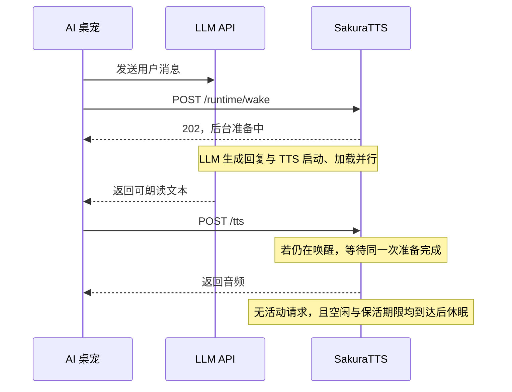

<h1 align="center">SakuraTTS</h1>

<p align="center">
  <strong>本地运行的 GPT-SoVITS 语音合成引擎</strong>
</p>

<p align="center">
  
  
  <a href="LICENSE"></a>
</p>

<p align="center">
  <a href="#快速开始">快速开始</a> ·
  <a href="#性能对比">性能对比</a> ·
  <a href="docs/api-v2-guide.md">API 文档</a> ·
  <a href="#休眠与唤醒">休眠与唤醒</a> ·
  <a href="docs/README.md">文档索引</a>
</p>

---

SakuraTTS 使用 GPT-SoVITS 模型在本机合成语音。你可以把一段文本生成为 WAV，在 Python 脚本里处理音频，也可以让配音工具、聊天机器人或桌宠通过 HTTP 调用同一个服务。完整整合包能直接导入已有的 GPT `.ckpt`、SoVITS `.pth` 和参考录音，首次使用时自动转换并缓存。

Windows 支持 CPU、NVIDIA CUDA 和 DirectML，Apple silicon 使用 MLX。CUDA 可以按显存选择四档配置。间歇使用语音的应用可以开启空闲休眠，在下次需要发声时再加载模型。设备、模型家族和原版 API v2 的兼容范围见[兼容矩阵](docs/specs/compatibility-matrix.md)。

## 快速开始

Windows 完整包自带 Python、运行库和模型转换工具，默认使用 CPU。两个语言版本都能选择 CPU、NVIDIA CUDA 或 DirectML。

| Windows x64 完整包 | 用途 |
| --- | --- |
| 日英版（`ja-en`） | 日语、英语及日英混读。沿用现有整合包的语言配置。 |
| 中日英版（`zh-ja-en`） | 在日英版基础上增加普通话发音词表、G2PW 和中文 BERT，用于中文参考录音与中文朗读。[普通话使用说明](docs/chinese-frontend.md) |

已公开的日英预览版可从[魔搭下载页](https://modelscope.cn/models/SuzushimaArisu/SakuraTTS)取得。中日英版当前为本地候选包。Apple silicon 用户见 [Mac 整合包](docs/portable-macos.md)，Linux 用户见 [Linux CPU 指南](docs/linux.md)。

准备一对受支持的 GPT / SoVITS 权重、一段参考录音和录音中的实际台词后，按以下步骤生成第一段语音。

1. 解压 Windows 包。CPU 使用 `configs/tts_infer.example.yaml`，NVIDIA 或 DirectML 使用 `configs/tts_infer.cuda.example.yaml` 或 `configs/tts_infer.directml.example.yaml`。将选中的模板复制为 `configs/tts_infer.yaml`，填写 `custom.t2s_weights_path` 和 `custom.vits_weights_path`。
2. 双击 `start-server.bat`。启动窗口会显示配置文件路径，首次转换时还会显示进度。看到“模型已加载”和“API 已启动”后，可访问 `http://127.0.0.1:9880/health`，默认启动方式下 `model_loaded: true` 表示模型已加载。有需要时可先运行 [对应后端的运行环境检查](docs/portable-bundle.md)。
3. 另开 PowerShell 窗口，执行下例生成 `hello.wav`。将参考音频路径和转写换成你自己的。本例使用日文参考和日文目标文本。

```powershell
$request = @{
    text           = 'こんにちは。'
    text_lang      = 'ja'
    ref_audio_path = 'D:/Voices/reference.wav'
    prompt_text    = '参考音声です。'
    prompt_lang    = 'ja'
} | ConvertTo-Json
Invoke-RestMethod -Method Post -Uri 'http://127.0.0.1:9880/tts' -ContentType 'application/json; charset=utf-8' -Body ([Text.Encoding]::UTF8.GetBytes($request)) -OutFile 'hello.wav'
```

首条请求会准备参考音频并缓存音频条件。启动窗口默认显示参考语言与转写、前端处理后的每句文本，以及语义 Token 预测和 SoVITS 合成的进度与耗时。需要查看完整请求参数或缓存来源时，可用 `.\start-server.bat --log-level debug` 启动，或查看 `logs/sakuratts.log`。请求示例、参数与错误响应见 [API V2 使用说明](docs/api-v2-guide.md)。

使用中日英包时，可用 `.\start-server.bat --backend cuda --runtime-mode managed --profile fp16` 启动同一个服务。把请求的 `text_lang` 切为 `zh`、`ja` 或 `en` 即可换朗读语言，`prompt_lang` 填参考录音的语言。需要省显存时把启动档位改为 `low-memory` 或 `minimum-memory`，这个选择对所有语言生效。

## 性能对比

### RTX 5070 Ti 上的中日英三档对照

普通话、日语和英语共用 **FP16 标准、低显存、极限** 三个档位。桌面 RTX 5070 Ti 16 GB 上，三种语言在每个档位的请求后显存相同。由标准切到极限，常驻显存从 **767 MB 降到 205 MB**。

| CUDA 档位 | 请求后显存（三语） | 普通话峰值 | 日语峰值 | 英语峰值 |
| --- | ---: | ---: | ---: | ---: |
| FP16 标准 | 767 MB | 886 MB | 897 MB | 894 MB |
| FP16 低显存 | 584 MB | 773 MB | 785 MB | 785 MB |
| FP16 极限 | 205 MB | 601 MB | 616 MB | 616 MB |

同一服务按普通话、日语、英语的顺序朗读“今天下午三点，我们在图书馆门口见”的三语文本。模型、档位、中文参考录音和随机种子都保持一致，只改变目标文本与语言。下表是从发出请求到收齐 WAV 的中位耗时。

| CUDA 档位 | 普通话（音频 3.10 秒） | 日语（4.02 秒） | 英语（4.02 秒） |
| --- | ---: | ---: | ---: |
| FP16 标准 | 0.218 秒 | 0.199 秒 | 0.181 秒 |
| FP16 低显存 | 0.816 秒 | 0.795 秒 | 0.847 秒 |
| FP16 极限 | 2.199 秒 | 2.242 秒 | 2.199 秒 |

测试使用 Wass V2ProPlus。显存表取短句和长句中的观测峰值，统计 Windows 服务进程树的专用显存，单位为十进制 MB。速度表取三语轮换的三轮热请求中位数，统一种子为 7。[三语实测、RTF 与样音核查](research/notes/windows-cuda-multilingual-20261120.md)

普通话文本前端使用 CPU。Ryzen 7 9700X 首次处理“今天下午三点，我们在图书馆门口见。”时，前端进程树新增约 **1.69 GiB 系统私有内存**，较原版少约 **400 MiB**。首次输入“森林。”时，词典即可确定读音，只加载中文 BERT，新增约 **1.36 GiB**。[中文前端内存与耗时](research/notes/windows-mandarin-frontend-memory-20261120.md)

### Windows 普通话整句耗时

使用 Wass V2ProPlus 合成普通话短句“今天是星期五，出门记得带伞。”，两种设备都生成了 3.02 秒音频。Ryzen 7 9700X 的均衡档耗时 **0.812 秒**，桌面 RTX 5070 Ti 的 CUDA FP32 档耗时 **0.219 秒**。每句预热一次，再取五次完整 HTTP 返回的中位数。[长句数据与整合包验收](research/notes/windows-mandarin-20261120.md)

### Windows 普通话首段延迟

“明天下午三点，我们在银行门口见面。去之前先看一下天气预报，如果下雨，记得带伞。”按句号分成两片（`cut3`）。开启分片流式输出后，客户端在 Ryzen 7 9700X 上等 **1.08 秒**就能开始播放，在桌面 RTX 5070 Ti 上等 **0.39 秒**。

| 设备与档位 | 输出模式 | 收到首段可播放音频 | 收齐整段音频 | 生成音频时长 |
| --- | --- | ---: | ---: | ---: |
| Ryzen 7 9700X · CPU balanced | 默认 | 2.23 秒 | 2.23 秒 | 7.64 秒 |
| Ryzen 7 9700X · CPU balanced | 分片流式 | 1.08 秒 | 2.22 秒 | 7.64 秒 |
| RTX 5070 Ti · CUDA FP32 | 默认 | 0.66 秒 | 0.66 秒 | 8.32 秒 |
| RTX 5070 Ti · CUDA FP32 | 分片流式 | 0.39 秒 | 0.69 秒 | 8.32 秒 |

本机 HTTP 服务使用 Wass V2ProPlus 模型、同一段中文参考录音和转写，固定种子 1234。模型常驻，每种输出模式预热一次，再各测三次取中位数。计时从客户端发出请求开始，首段取读完 WAV 头并收到前 20 毫秒 PCM 的时刻，整段取响应读完的时刻。播放器缓冲另计。请求中设置 `streaming_mode=1` 即可按片返回音频。

### 不同 Windows 设备的日文合成速度

从发出请求到收到完整 WAV，桌面 RTX 5060 Ti 的中位耗时为 **0.94 秒**，RTX 5060 笔记本为 **1.74 秒**，RTX 3050 笔记本为 **3.39 秒**。表中各设备使用各自的模型、文本和设置。

| 设备及后端 | 请求数 | 安装数 | 耗时 P50 | 耗时 P95 | RTF P50 |
| --- | ---: | ---: | ---: | ---: | ---: |
| GeForce RTX 5060 Ti（台式，CUDA） | 1,349 | 2 | 0.938 秒 | 8.125 秒 | 0.098 |
| GeForce RTX 5060 Laptop GPU（CUDA） | 759 | 4 | 1.735 秒 | 8.281 秒 | 0.114 |
| GeForce RTX 4060 Laptop GPU（CUDA） | 527 | 6 | 2.235 秒 | 20.859 秒 | 0.177 |
| GeForce RTX 5070 Ti Laptop GPU（CUDA） | 145 | 1 | 1.484 秒 | 3.296 秒 | 0.088 |
| GeForce RTX 3050 Laptop GPU（CUDA） | 140 | 1 | 3.391 秒 | 8.610 秒 | 0.209 |
| GeForce RTX 5070 Laptop GPU（CUDA） | 26 | 1 | 2.094 秒 | 9.500 秒 | 0.092 |
| GeForce RTX 4060 Ti（台式，CUDA） | 21 | 1 | 2.032 秒 | 15.656 秒 | 0.172 |
| CPU | 1,668 | 7 | 9.157 秒 | 22.937 秒 | 0.765 |
| DirectML | 200 | 1 | 2.360 秒 | 9.735 秒 | 0.188 |

数据来自 Sakura 桌宠 1.4.0 于 2026 年 11 月 14 日 03:06 至 20 日 02:28（北京时间）完成的 4,835 次 Windows 日文请求。RTX 4060 笔记本有 289 次使用 10 月 7 日版整合包，其余请求使用 10 月 17 日版。P50 和 P95 用最近秩法计算。RTF 是耗时与生成音频时长的比值，小于 1 表示合成快于播放。

### Radeon 780M 核显

2026 年 9 月 27 日，在 Ryzen 7 7840HS 笔记本上，Radeon 780M 使用 DirectML FP16、KV 容量 1280 和 N.A.V.I. 日文模型。短句生成 3.42 秒音频，耗时中位数 **1.272 秒**；长句生成 20.70 秒音频，耗时中位数 **8.278 秒**。每句预热一次、热测三次，计时到完整 PCM 返回。[同机 CPU 和核显实测](research/notes/genie-comparison-20260927.md)

### GeForce RTX 5060 桌面卡的显存与速度

2026 年 9 月 21 日，在 RTX 5060 8 GB、Windows 11 WDDM 上测试 Sakura V2ProPlus 日文模型。每组使用相同权重、参考、文本和采样参数，执行两轮共 12 次请求，覆盖短句、长句和多句文本。

显存与同精度原版比较，单位为十进制 MB。† 表示沿用上一轮原版数据的跨轮次参考，低显存档和极限档所在轮次没有重跑原版。

#### 峰值显存

| 精度与配置 | 原版观测峰值 | SakuraTTS 观测峰值 | 峰值降低 |
| --- | ---: | ---: | ---: |
| FP32 默认档 | 3931.7 MB | 2148.6 MB | **45.4%** |
| FP16 标准档 | 2323.2 MB | 758.2 MB | **67.4%** |
| FP16 低显存档 † | 2323.2 MB | 584.1 MB | **74.9%** † |
| FP16 极限档 † | 2323.2 MB | 465.1 MB | **80.0%** † |

#### 请求后空闲显存

空闲显存取最后一次请求结束后约 1 秒，推理进程仍在运行。

| 精度与配置 | 原版空闲显存 | SakuraTTS 空闲显存 | 空闲降低 |
| --- | ---: | ---: | ---: |
| FP32 默认档 | 3076.0 MB | 1253.1 MB | **59.3%** |
| FP16 标准档 | 1677.2 MB | 569.4 MB | **66.0%** |
| FP16 低显存档 † | 1677.2 MB | 387.0 MB | **76.9%** † |
| FP16 极限档 † | 1677.2 MB | 106.5 MB | **93.7%** † |

#### 热请求耗时

下表为已经加载模型后，生成**完整音频**的耗时中位数。短句取 3 次、长句取 2 次，测量期间持续采集显存。

| 引擎与配置 | 热短句耗时 | 热长句耗时 | 输出音频时长（短句 / 长句） |
| --- | ---: | ---: | ---: |
| 原版 FP32 | 0.615 s | 5.548 s | 2.02 / 27.30 s |
| SakuraTTS FP32 默认档 | **0.289 s** | **3.290 s** | 3.46 / 25.90 s |
| 原版 FP16 | 0.508 s | 4.407 s | 2.02 / 27.30 s |
| SakuraTTS FP16 标准档 | **0.234 s** | **2.677 s** | 3.46 / 25.46 s |
| SakuraTTS FP16 低显存档 | 1.009 s | 3.560 s | 3.46 / 25.46 s |
| SakuraTTS FP16 极限档 | 3.055 s | 5.481 s | 3.46 / 25.46 s |

CUDA 的 FP16 标准档适合连续短句。低显存档与极限档在每段合成时重新加载部分模型，进一步降低显存峰值，也增加等待时间。默认档为 FP32，FP16 需要匹配的转换模型包。这组 FP16 样本的人工听感验收仍待完成。[推理档位](docs/inference-profiles.md)

<details>
<summary>测量口径与数据来源</summary>

显存取 WDDM 的 Dedicated Usage，对主进程与声学工作进程在同一时刻的读数求和，再取采样峰值。降幅用未舍入的读数计算。各组使用已准备好的模型和参考条件，两套引擎的随机数实现会影响生成的音频时长。[同精度实测报告](https://github.com/Rvosy/SakuraTTS/blob/main/research/notes/low-vram-20260921.md) · [声学错峰报告](https://github.com/Rvosy/SakuraTTS/blob/main/research/notes/acoustic-session-staging-20260921.md)

原版两档与 SakuraTTS FP32 取自首轮，SakuraTTS 三个 FP16 档的读数取自后续声学错峰轮次。[首轮原始数据](https://github.com/Rvosy/SakuraTTS/blob/main/research/experiments/data/2026-09-21-low-vram.json) · [错峰轮次原始数据](https://github.com/Rvosy/SakuraTTS/blob/main/research/experiments/data/2026-09-21-acoustic-session-staging.json)

</details>

## 休眠与唤醒

启用 `managed` 模式后，HTTP 服务保持运行，推理进程按需启动。没有活动请求且空闲与保活期限均到达时，推理进程及其子进程退出，释放它们持有的 GPU 资源。

```powershell
.\start-server.bat -c configs/tts_infer.yaml --runtime-mode managed --idle-sleep-seconds 60
```

配音工具可以在用户开始编辑台词时唤醒引擎。聊天机器人和桌宠则可在发出 LLM 请求时调用 `/runtime/wake`，让模型加载与回复生成并行。文字准备好后提交 `/tts` 即可。



下例让服务保活 60 秒。

```http
POST /runtime/wake
Content-Type: application/json

{"keep_alive_seconds":60}
```

直接调用 `/tts` 也会唤醒引擎，并等待模型就绪。使用流式 LLM 时，客户端可以在第一句形成后发起合成，再串行提交后续句子。极限档按片段重载模型，提前唤醒只准备运行环境。[后台运行、预热与播放队列](docs/background-runtime.md)

在 RTX 5060 的 Windows 测试中，标准档休眠后，推理进程树退出，对应的 GPU 计数实例消失。30 秒内测得控制服务及启动器的系统内存 RSS 中位数为 68.0 MB。同机另完成 100 轮睡醒，每轮都确认推理子进程退出。[Windows 睡醒实测](https://github.com/Rvosy/SakuraTTS/blob/main/research/notes/managed-refinement-20260922.md)

2026 年 10 月 26 日，2 vCPU 的 Linux ECS 使用 CPU 极限省内存档生成一条日文语音。服务进程树的 RSS 在合成结束后为 440.50 MiB，空闲 60 秒自动休眠后为 41.36 MiB。此时 cgroup 共记账 576.95 MiB，其中 544.89 MiB 是文件缓存。[Linux 待机补测](research/notes/maibot-engine-integration-20261026.md)

## 文档

| 需求 | 入口 |
| --- | --- |
| 安装、模型准备与首次生成 | [快速开始](docs/quickstart.md)、[Windows 整合包](docs/portable-bundle.md) |
| 桌宠接入、休眠、唤醒与预热 | [后台运行](docs/background-runtime.md) |
| HTTP 请求与服务配置 | [API V2 使用说明](docs/api-v2-guide.md)、[HTTP API](docs/http-api.md) |
| 精度、显存与延迟取舍 | [推理档位](docs/inference-profiles.md) |
| 嵌入 Python 或准备模型包 | [Python API](docs/python-api.md)、[模型目录](docs/model-format.md) |
| 参与开发 | [开发指南](docs/development.md)、[架构](docs/architecture.md) |
| 其他指南与规范 | [文档索引](docs/README.md) |

## 许可与致谢

SakuraTTS 基于 [GPT-SoVITS](https://github.com/RVC-Boss/GPT-SoVITS) 的模型与推理研究构建独立运行引擎。项目早期参考了 [GSV-TTS-Lite](https://github.com/chinokikiss/GSV-TTS-Lite) 和 [Genie-TTS](https://github.com/High-Logic/Genie-TTS) 的推理实现与工程组织，感谢这些项目的作者和贡献者。

项目代码采用 [MIT](LICENSE)，第三方代码和字典声明见 [docs/third-party](docs/third-party)。角色模型、参考音频和 NVIDIA 运行库适用各自的许可。
